<div align="center">



</div>


<a href="https://github.com/slimefrozik/VKMusicSaver">
  
</a>





<details>
  <summary>♥ <b>Open the config</b></summary>
  <br/>

```yaml
alias: slimefrozik
status: vibecoding & experimenting
current_gem: VKMusicSaver
rule_of_thumb: "Code is just a tool to solve problems — no matter how it was written."
```

</details>


